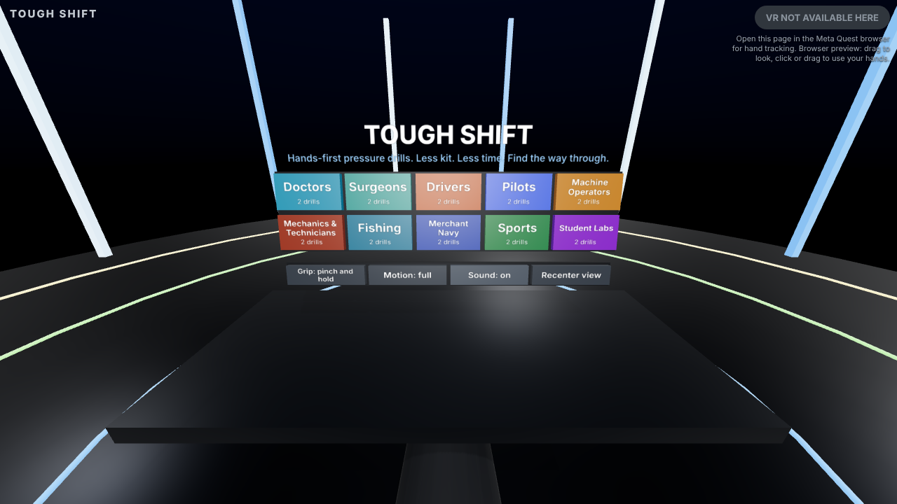
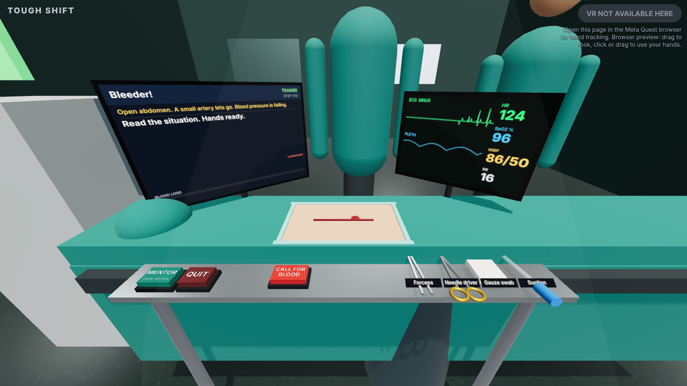
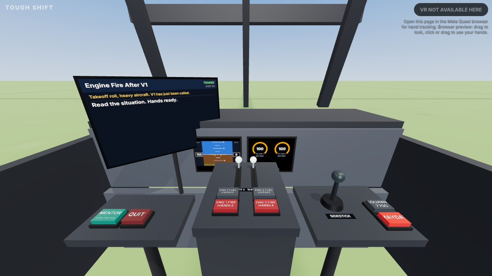
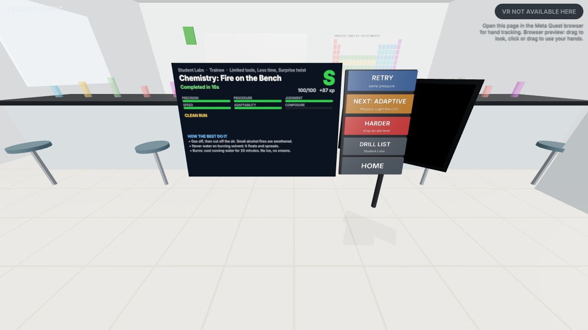

# TOUGH SHIFT

Hands-first pressure drills for people who work with their hands: doctors, surgeons, drivers, pilots, crane operators, mechanics, fishing crews, merchant navy officers, athletes and students in the lab.

**Play:** open the GitHub Pages URL of this repo in the Meta Quest browser and press **ENTER VR**. No controllers needed: poke buttons with a fingertip, pinch to grab tools, levers, sticks and wheels. It also runs in any desktop browser as a preview (drag to look, click or drag to interact).

## What is in it
- 10 worlds, 20 drills, each a real scenario with consequences.
- **Aids** at three levels (Trainee, Pro, Expert): mentor text, highlight arrows, ghost paths, steadied tools. They fade as your tier rises.
- **Pressure dials**: limited tools, less time, tight precision, more at once, surprise twist.
- **Improvise**: when the right tool is missing, fabricate one from what is on the tray.
- **Adaptive Shift** picks the next drill and pressure from your weakest skill.
- Seated, everything within arm's reach, each drill under 5 minutes.

## Tech
Single self-contained `index.html`: Three.js + WebXR hand tracking, PBR materials, image-based lighting, soft shadows, procedural environments and audio. No external assets or services.

This is a training game prototype, not certified professional instruction.

## Screenshots





## Build from source
```
npm install
npm run build      # bundles src/ into the single index.html
```
Source lives in `src/`: `engine.js` (hands, grabbing, step engine, aids, scoring, menus), `envs.js` (the 10 environments), `sims.js` (driving, flight, crane and ship models), `tools.js` (hand tools), `drills.js` and `drills2.js` (the 20 scenarios).

## Test
`tests/autoplay.py` drives a headless Chrome (Playwright) through every drill with a built-in bot and reports any drill that fails to finish or throws. Run it from the repo root: `python3 tests/autoplay.py '{limited:true,twist:true}'`.

Hand tracking on a real headset has not been verified yet; the automated run covers the browser preview path only.

## License
Copyright 2026 The TOUGH SHIFT Authors.

Licensed under the Apache License, Version 2.0. See [LICENSE](LICENSE) and [NOTICE](NOTICE). Every source file, the build script, the test script and the built `index.html` carry the licence header.

The built `index.html` bundles three.js, which is MIT licensed. See [THIRD_PARTY_NOTICES.md](THIRD_PARTY_NOTICES.md).
